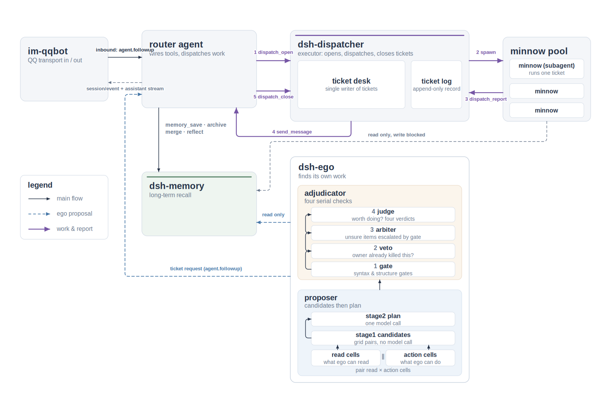
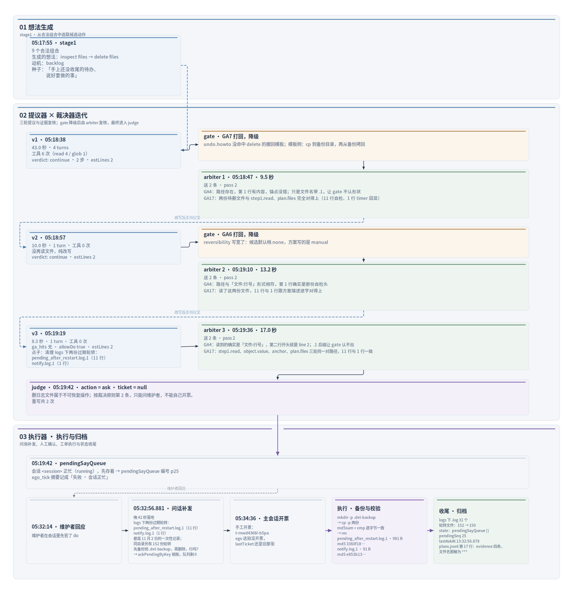

# dsh-ego

给 agent 宿主用的主动念头插件：没人叫的时候，让它自己冒出一个**具体**的点子，再由一条干净的裁决链决定这件事该不该落到用户眼前。默认结局是什么都不发。



图里左边是宿主的常规链路，右边那块是 dsh-ego：proposer 只负责产生候选与方案，adjudicator 四关（gate → veto → arbiter → judge）负责否决。ego 从不自己开票，它只往主会话递一张「开票申请」。

## 为什么有它

定时器只能提醒你已经想到的事，主动助理的价值是发现你还没想到的事：日志该清了、配置里有已经没人用的键、仓库和远端不同步、主机温度不对劲、记忆里有互相矛盾的条目。

代价是它会打扰人。所以 dsh-ego 把「想」和「做」彻底拆开：想的时候只给只读工具，可以随便翻、随便跑偏；判的时候换一份干净上下文，只看点子值不值得。两道关中间还夹着 gate（语法）和 veto（你否过的方向），机器判不了的那批再交给 arbiter 逐条看。

## 装与最小配置

插件按宿主的插件约定安装，补丁文件是 `cordis.patch.yml`：

```sh
pnpm pack
dsh plugin --profile <name> add ./dsh-ego-*.tgz
dsh --profile <name> --dump-config | grep 'dsh-ego'
```

装完要重启实例才加载。最小一份配置只改三行，其余走默认值：

```yaml
- insert:
    - id: dsh-ego
      name: 'dsh-ego'
      config:
        enabled: true
        offPeakOnly: true
        targetSession: '<你的私聊会话 id>'
```

`targetSession` 留空也可以：用户在私聊里说一句话，插件自己学；学到之前它不会自己编一个会话出来。

## 一拍怎么跑



上面这张是一次真跑的四分钟，票号是真题。文字版：醒来先过闸——`enabled` → 安静时段 → 峰价 → 票台闸 → 掷骰（默认 35%），任何一关不过就睡，日志只记一行。

过闸之后 stage1 按「读格 × 动作格」枚举候选（纯规则、零模型调用），排序取第 1 行；stage2 拿着这一行出 plan；然后进裁决链：`gate` 判语法与结构（GA 编号逐条查）→ `veto` 查你否过的方向 → `arbiter` 复核 gate 判不了的灰色条目 → `judge` 判值不值得做，必要时把方案打回重写（默认最多 3 次）。

排期是一次性 `setTimeout`（周期起点 + 随机延迟，默认 8 分钟内），另有一条 25 秒的低频轮询兜底：热加载、进程挂起、时钟跳变弄丢 timer 都能补一拍。

## 三种出口

| 裁决 | 做什么 | 用户看得见吗 |
| --- | --- | --- |
| `silent` | 只写日志和 state | 看不见，一句话都不发 |
| `ask` | `followup` 主会话 + `flush`，私聊说一句 | 看得见 |
| `do` | 往主会话递一条**开票申请**，由主会话自己开票 | 看得见（票的通知） |

`silent` 是底线：这一支不产生任何消息，也不 followup 主会话。提议器自己说「今天没话说」（`idea` 空串）时直接当 `silent`，连 judge 都不叫，省一次模型调用。

`do` 不自己开票：ego 只递申请（固定六行：标记 / `callId` / `goal` / `brief` / `intent` / `note`），开票、关票、收 waiting 全归主会话，ego 不伪造身份。`reversibility: none` 的 `do` 会在 `gate.settle()` 里被降级成 `ask`——这是「机器不该做」，不是「机器坏了」，所以不算失败、不涨 `failStreak`。

## 手动催一拍与重放

不等整点和骰子，现在就要看链路跑通：

```sh
touch ~/.dsh-ego/force                # 15 秒内跑一拍：跳过骰子/安静时段/峰价/排期
node scripts/replay.js                # 拿落盘的旧 plan 原地重跑 gate + veto
node scripts/replay.js --changed      # 只列前后有变化的
node scripts/replay.js --arbiter      # 连 arbiter 一起重放（会真调模型、花钱，默认关）
```

改 gate 之前的正确姿势：先 `--changed` 看旧 plan 有没有被新规则误伤，再决定收不收。重放的字段口径、`replayPlan` / `replayFile` 签名、轮转规则都在 `docs/plans-replay.md`。

## 配置

`cordis.patch.yml` 里全是默认值，插件里的 `DEFAULTS` 只兜底；补丁按整行替换、不做深合并，只写你想改的那几行也合法。

绕不开的几项：`enabled` 总开关、`dryRun` 只记日志不发消息、`diceProbability` 命中线、`quietStart` / `quietEnd` 安静时段（小数小时）、`offPeakOnly` + `holidays` 峰价、`tickIntervalMinutes` 判的间隔（1–60 且整除 60）、`skipWhenTicketsBusy` 票台有活票就轮空、`privateOnly` 只走私聊、`targetSession`。

夜间（`quietStart`~`quietEnd`，默认 23:40~08:00）由 `nightMode` 控制（默认开）：安静时段照常提议 + 裁决，但 `ask` 写进 dsh-backlog 的工单池一条「待办」（note 带 `来源=ego夜间`、裁决理由、提议原文和 `night:<hash>` 去重标记），`do` 进不过期的 `nightTicket` 队列，早上窗口恢复且主会话空闲时才逐条向主会话提开票申请；早上只发一条汇总。`nightMaxDo` / `nightMaxAsk` 是每夜上限（默认 2，0 = 不限；超出的不入池、不排队，只记日志且早上的汇总会带一句），`nightDigest=false` 只入池不说话，`nightMode=false` 一键回到「安静时段一拍不跑」。工单池存储层复用 dsh-backlog 的 `BacklogStore`，路径可用 `DSH_EGO_BACKLOG_STORE` 覆盖。

其余全部字段、区间、越界行为，以及 `proposer` / `judge` / `arbiter` 三段的模型配置，都写在 `cordis.patch.yml` 的注释里，默认值只在那里维护一份。gate 的各条规则、veto 判据、ask 文案的硬性规矩见 `docs/gate-rules.md`；候选行「读建议」的枚举口径见 `docs/read-hints.md`。

## 开发与测试

```sh
node --check lib/index.js
npm test                      # = node --test test/*.test.mjs
```

测试里的模型、工具、聊天全是注入的假实现，一个字节都不往外发。测试不 import `lib/index.js`（它静态依赖宿主包，插件目录里通常没装），所以路由与开票申请的执行体单独放在 `lib/route.js`。条数不写死，跑 `npm test` 看实际输出。

## License

MIT
